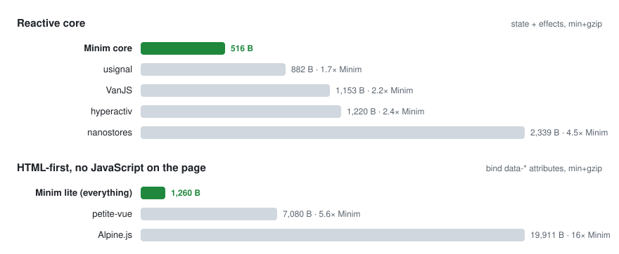

<p align="center">
  <picture>
    <source media="(prefers-color-scheme: dark)" srcset="docs/wordmark-dark.svg">
    
  </picture>
</p>

<h3 align="center">The smallest HTML-first reactive library.</h3>

<p align="center">
  <b>0.5 KB</b> core &nbsp;·&nbsp; <b>1.2 KB</b> paste-in &nbsp;·&nbsp; <b>2.5 KB</b> with lists, classes and animation &nbsp;·&nbsp; zero JavaScript on the page &nbsp;·&nbsp; nothing <code>eval</code>'d
</p>

<p align="center">
  
  
  
  <a href="https://github.com/hertonwork/minim/actions/workflows/ci.yml"></a>
  
</p>

## Size matters

<picture>
  <source media="(prefers-color-scheme: dark)" srcset="docs/size-dark.svg">
  
</picture>

<sub>Same ruler for everyone: latest npm source, terser, <code>gzip -9</code>. Brotli numbers and the method are in <a href="#the-numbers">the table below</a>.</sub>

## Ten seconds

```html
<script type="application/json" data-state="app">{ "name": "", "count": 0, "showName": true }</script>

<input data-model="name" placeholder="Your name">
<p data-show="showName">Hello, <strong data-watch="name"></strong>!</p>
<button type="button" commandfor="root" command="--inc" value="count">clicked <span data-watch="count"></span> times</button>

<script type="module" src="https://cdn.jsdelivr.net/npm/minimjs@3/dist/index.js"></script>
```

That is a complete page. The state lives in the JSON tag, the input and the text bind by key, the button needs no handler.
Open the console and type `app.count = 100` — the page follows.

## Why

- **Your server already renders the HTML.** PHP, Rails, Django, htmx — the markup exists. Minim makes it reactive in place instead of asking you to rebuild it in JavaScript.
- **Paste it in `<head>` and you're done.** The lite build is one `<script>` tag of 1.2 KB. No install, no import, no bundler, no build.
- **Nothing is `eval`'d.** Attributes name state *keys*, never expressions, so it runs under a strict Content-Security-Policy. Alpine needs `unsafe-eval`; Minim doesn't.
- **Buttons work without JavaScript.** `command="--inc"` / `--toggle` / `--set` / `--push` ride the HTML Invoker Commands API that every current browser ships.
- **Late markup binds itself.** Fragments from `fetch`, htmx swaps or server partials are picked up automatically; removed elements release their bindings.
- **Tiny because it's narrow.** Seven attributes, five commands, dotted paths. No expression language — state names keys, CSS does the animation, `<template>` does the lists. Reach for Alpine or Vue when you need expressions.
- **It scores 100.** [The demo page](https://hertonwork.github.io/minim/) ships as one HTML file with Minim inlined: one request, Lighthouse 100/100/100/100 on mobile and desktop.

A *minim* is the smallest unit of liquid measure. It's also a palindrome. Formerly published as JsUpdatr.

## Three ways to load it

```html
<!-- 1. Paste-in (lite/): one <script> in <head>, 1.2 KB gzipped — the snippet is in lite/README.md -->

<!-- 2. ES module, auto-boots -->
<script type="module" src="https://cdn.jsdelivr.net/npm/minimjs@3/dist/index.js"></script>

<!-- 3. Classic script: exposes window.minim and auto-boots -->
<script src="https://cdn.jsdelivr.net/npm/minimjs@3/dist/minim.min.js" defer></script>
```

```sh
npm install minimjs
```

```js
import { reactive, effect, bind } from 'minimjs';
```

## Reference

### State is JSON in the page

```html
<script type="application/json" data-state="app">
  { "name": "", "count": 0, "user": { "city": "Naples" }, "todos": [] }
</script>
```

Every such tag becomes a live, deep-reactive `window.app` (the name comes from `data-state`). Optional
`data-root="some-id"` limits binding to that element instead of `<body>`.

From PHP: `<script type="application/json" data-state="app"><?= json_encode($state, JSON_HEX_TAG|JSON_HEX_AMP) ?></script>`

### Attributes

| Attribute | On | Does |
|---|---|---|
| `data-model="key"` | `input`, `textarea`, `select` | Two-way. Checkboxes use `checked`; `type=number`/`range` store Numbers. |
| `data-watch="key"` | any element | Sets `textContent` to the value. |
| `data-show="key"` | any element | Toggles the `hidden` attribute (truthy = shown). |
| `data-bind="attr:key --var:key"` | any element | Mirrors values into attributes, or into CSS custom properties when the name starts with `--`. `false`/`null` removes, `true` sets empty. |
| `data-class="name:key"` | any element | Toggles a class on the truthiness of the key. Pair it with CSS transitions and keyframes. |
| `data-each="key"` | `<template>` | Stamps the template once per item of the array. Inside: `$` is the item, `$.field` one of its fields, `$i` its index; attribute values that are exactly `$i` or `$` are substituted. Re-renders through the View Transitions API where available. |
| `data-command="event:--cmd"` | any element | Runs a command on a DOM event, e.g. `keydown.Enter:--push` (the part after the dot filters `event.key`). The element supplies `value`, `data-key`, `data-step`. |

Keys can be dotted paths: `data-model="user.city"`, `data-watch="todos.length"`.

Pre-render the initial state in the HTML (the initial text inside `data-watch` elements, `hidden` on `data-show` elements that
start hidden): Minim then only keeps it in sync, and nothing moves on load. Markup inserted later (`fetch` +
`insertAdjacentHTML`, htmx swaps, server fragments) is bound automatically; removed elements release their bindings.

### Buttons

`commandfor` points at the bound root (`<body id="…">` or the `data-root` element); use `type="button"`.

```html
<body id="root">
  <button type="button" commandfor="root" command="--inc"    value="count">+1</button>
  <button type="button" commandfor="root" command="--inc"    value="count" data-step="-1">−1</button>
  <button type="button" commandfor="root" command="--toggle" value="showName">show/hide</button>
  <button type="button" commandfor="root" command="--set"    data-key="user.city" value="Miami">Miami</button>
  <button type="button" commandfor="root" command="--push"   data-key="todos" value="buy milk">add</button>
```

| Command | Reads | Effect |
|---|---|---|
| `--inc` | `value` = key, `data-step` (default 1) | `state[key] += step` |
| `--toggle` | `value` = key | `state[key] = !state[key]` |
| `--set` | `data-key`, `value` | `state[key] = value` (numeric strings become Numbers) |
| `--push` | `data-key` (an array), `value`, optional `data-as` | `state[key].push(value)`, or `push({ [as]: value })` with `data-as="text"`; from an input, clears it afterwards |
| `--remove` | `data-key` (an array), `value` = index | `state[key].splice(index, 1)` |

### JavaScript API

```js
import { reactive, effect, bind, tick } from 'minimjs';

const state = reactive({ count: 0, items: [] });   // deep: nested objects, arrays and new keys all react

const stop = effect(() => console.log(state.count)); // runs now, re-runs when what it read changes
state.count++;                                       // writes are batched into one re-run per microtask
await tick();                                        // wait for pending effects (tests)
stop();

const ctrl = new AbortController();
effect(() => { /* … */ }, { signal: ctrl.signal });  // or stop it through an AbortSignal…
bind(document.getElementById('widget'), state);       // …bind a subtree yourself; returns an AbortController
ctrl.abort();                                         // that tears down every effect and listener it created
```

An effect that writes what it reads is stopped after 100 rounds with a `console.error` instead of freezing the tab.
Types ship with the package (`dist/index.d.ts`).

**Module build vs lite:** the paste-in lite has `data-model` / `data-watch` / `data-show` / `data-bind` and the four basic
commands. The module build (2.5 KB) adds `data-class`, `data-each`, `data-command`, CSS-variable binds, `--remove`, tracking of
`Object.keys(state)` inside effects, a click fallback for browsers without `command` events, and `AbortController` teardown.

## The numbers

Latest npm source of each library, terser, `gzip -9`, brotli 11 — the same pipeline for every row.

| | minified | gzip | brotli | what's inside |
|---|---|---|---|---|
| **Minim core** (`reactive` + `effect`) | **868** | **516** | **471** | deep reactive state + effects |
| usignal | 1,900 | 882 | 797 | signals only |
| VanJS core | 2,365 | 1,153 | 1,046 | state + `tags` DOM builder (UI is built in JS) |
| hyperactiv | 2,328 | 1,220 | 1,104 | observable objects + computed |
| **Minim lite** (everything, paste-in) | **2,385** | **1,260** | **1,131** | core + `data-*` bindings + buttons + late-DOM binding + JSON boot |
| nanostores | 5,247 | 2,339 | 2,126 | stores |
| petite-vue 0.4 (`iife`) | 16,901 | 7,080 | 6,513 | HTML directives with expressions |
| Alpine.js 3.17 (`cdn.min.js`) | 55,935 | 19,911 | 18,029 | HTML directives with expressions, needs `unsafe-eval` |

Regenerate the chart after editing the numbers: `node docs/size-chart.mjs`. Current lite size: `npm run size`.

## Migrating from JsUpdatr v2

- `JsUpdatr.observe(obj)` is now `reactive(obj)` and **returns a Proxy**. v2 mutated the object in place; v3 does not,
  so keep and use the returned object: `const state = reactive(document.state)`.
- `JsUpdatr.run(fn)` is now `effect(fn)`, which returns a stop function and batches re-runs in a microtask instead of
  running them synchronously.
- The `data-model` / `data-watch` / `data-watch-attributes` glue from the old README is now built in;
  `data-watch-attributes="smallest:min"` became `data-bind="min:smallest"` (attribute first).
- `JsUpdatr`, `JsUpdatr.observe` and `JsUpdatr.run` remain as aliases so old code keeps working after the one-line change above.

## Build a page with an agent

`skills/minim-page/` is an agent skill (Claude Code, Cursor, Codex and friends) that builds one-file pages on Minim
scoring 100/100/100/100 on PageSpeed with zero external JavaScript or CSS: a starter page with tokens and dark mode, both
Minim builds to inline, an inliner, a preflight checker that maps to the Lighthouse audits, and the design rules that
got the demo there.

```sh
npx skills add hertonwork/minim        # installs skills/minim-page
node skills/minim-page/scripts/check.mjs page.html --lighthouse
```

## Development

```sh
npm install
npm test               # builds dist/, lite/ and index.html (tsc + esbuild), regenerates lite/README.md, runs the node:test suite
npm run test:browser   # headless-Chromium checks against index.html (needs `npm i -D playwright`)
npm run test:lite      # the lite build's tests
npm run size           # current lite size
```

The demo at [hertonwork.github.io/minim](https://hertonwork.github.io/minim) is built from `docs/index.template.html` with
`dist/minim.min.js` and the size chart inlined (`npm run build:page`); edit the template, not `index.html`.

## License

[MPL-2.0](https://opensource.org/licenses/MPL-2.0)
